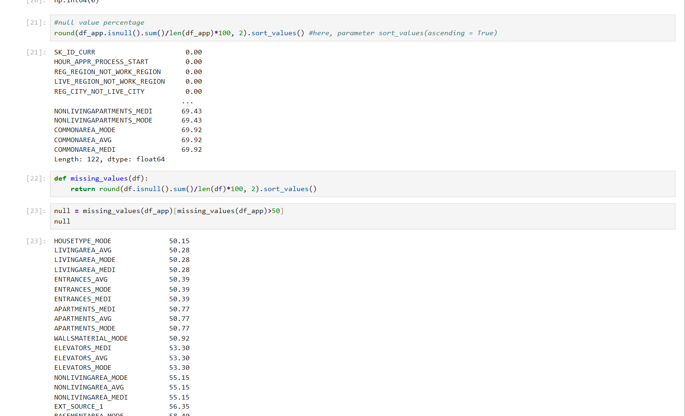
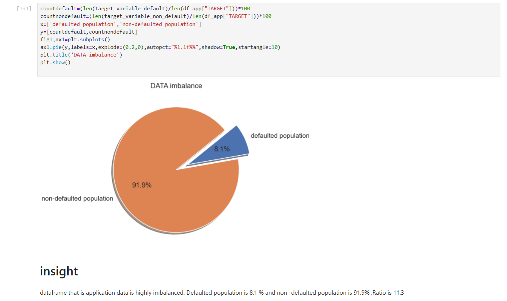
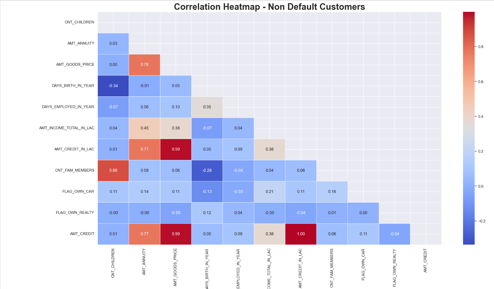
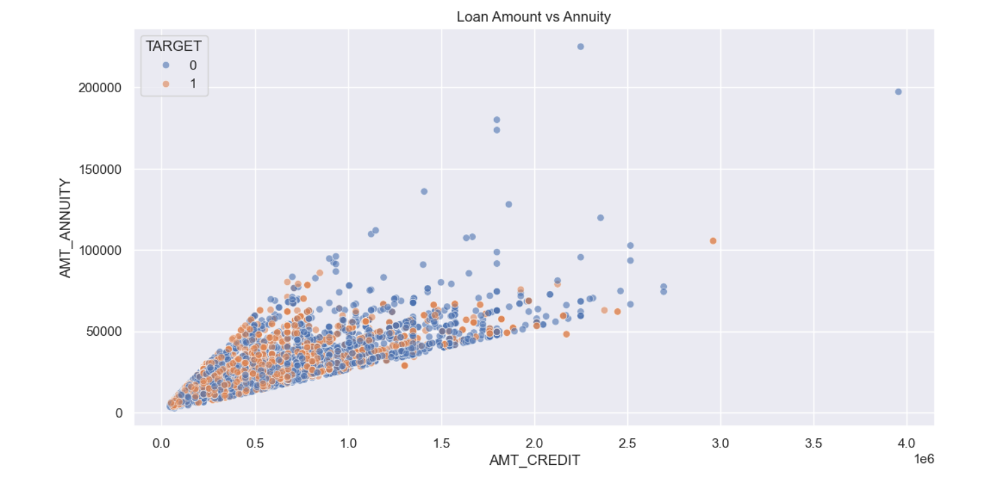
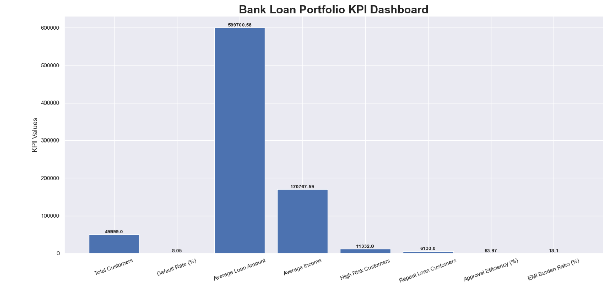

# 🎯 Banking Risk Analytics & Loan Default Analysis


---

# 📌 Overview

This project demonstrates a complete **Banking Risk Analytics and Loan Default Analysis workflow** using Python and real-world financial datasets.

The project focuses on understanding customer financial behavior, repayment difficulties, loan default patterns, employment stability, income segmentation, historical loan applications, and credit risk indicators through advanced **Exploratory Data Analysis (EDA)**.

Using powerful Python libraries such as **Pandas, NumPy, Matplotlib, and Seaborn**, the project performs:

- Data Cleaning
- Missing Value Treatment
- Feature Engineering
- Exploratory Data Analysis (EDA)
- Correlation Analysis
- Customer Risk Segmentation
- KPI Dashboard Creation
- Previous vs Current Loan Analysis
- Advanced Business Insights
- Financial Risk Visualization

The entire workflow is implemented using **Jupyter Notebook** following a structured end-to-end analytics pipeline.

---

# 🧠 Business Problem

Financial institutions face significant challenges in identifying high-risk loan applicants and minimizing loan defaults.

The objective of this project is to analyze customer-level banking data and uncover patterns associated with:

- Loan repayment difficulties
- Financial instability
- Employment risk
- Customer borrowing behavior
- Credit affordability
- Previous loan application history

The analysis helps banks and financial institutions improve:

- Credit risk assessment
- Loan approval strategies
- Customer segmentation
- Portfolio monitoring
- Lending efficiency

---

# 🏗️ Project Workflow

```text
Raw CSV Data → Data Cleaning → Feature Engineering → Exploratory Data Analysis → Visualization → Business Insights → KPI Dashboard
```

---

# 📂 Dataset Overview

The project uses two major banking datasets.

| Dataset | Description |
|---|---|
| application_data.csv | Current customer loan application data |
| previous_application.csv | Historical customer loan application records |
| columns_description.csv | Contains description of each column |

---

# 🔄 End-to-End Workflow

## 🔹 1. Data Importing

- Imported structured CSV datasets using Pandas
- Created analytical DataFrames
- Organized notebook workflow

```python
import pandas as pd

df_app = pd.read_csv("data/application_data.csv")
df_prev = pd.read_csv("data/previous_application.csv")
```

---

## 🔹 2. Data Cleaning

Performed preprocessing tasks such as:

- Handling missing values
- Null percentage analysis
- Removing highly null columns
- Outlier analysis using IQR
- Data type corrections
- Standardizing categorical variables

---

## 🔹 3. Feature Engineering

Created multiple business-driven features including:

- Income Segmentation
- Credit Ratio
- Age Buckets
- Employment Duration Groups
- EMI Burden Ratio
- Credit Amount Categories
- Loan Affordability Features

---

## 🔹 4. Exploratory Data Analysis (EDA)

Conducted extensive EDA including:

- Univariate Analysis
- Bivariate Analysis
- Correlation Analysis
- Pairplots
- Risk Pattern Analysis
- Default vs Non-Default Comparison

---

## 🔹 5. Data Visualization

Created multiple financial and risk visualizations using:

- Matplotlib
- Seaborn

### 📊 Visualizations Included

- Histograms
- Countplots
- Scatterplots
- Boxplots
- Pie Charts
- Heatmaps
- Pairplots
- KPI Charts
- Risk Distribution Graphs

---

# 📸 Project Screenshots

## 🟦 Missing Value Analysis



---

## 🟩 Customer Default Distribution



---

## 🟨 Correlation Heatmap



---

## 🟥 Loan Amount vs Annuity




---

## 🟪 KPI Dashboard


---

# 📊 Key Business Insights

- Low-income customers showed higher repayment difficulties
- Customers with unstable employment history had elevated default risk
- High EMI burden increased loan repayment stress
- Repeat borrowers showed higher financial risk patterns
- Historical application behavior impacted current default probability
- Middle-income groups formed the largest loan applicant segment
- Employment stability significantly influenced repayment reliability

---

# 🚀 Tech Stack

| Technology | Purpose |
|---|---|
| Python | Core Programming |
| Pandas | Data Manipulation |
| NumPy | Numerical Operations |
| Matplotlib | Visualization |
| Seaborn | Statistical Visualization |
| Jupyter Notebook | Development Environment |

---

# 📁 Project Structure

```text
bank-loan-default-risk-analysis/
│
├── datasets/
│   ├── cleaned/
│   │   ├── application_data.csv
│   │   └── previous_application.scv
│   ├── raw/
│   │   ├── application_data.csv
│   │   └── previous_application.scv
│   │   
│   └── columns_description.csv
│
├── notebooks/
│   └── bank_loan_case study.ipynb
│
├── images/
│   ├── missing_values.png
│   ├── default_distribution.png
│   ├── heatmap.png
│   ├── loan_annuity_analysis.png
│   └── kpi_dashboard.png
│
├── ppt/
│   ├── Banking_Risk_Analtytics.pptx
│   └── Banking_Risk_Analtytics.pdf
│
├── README.md
├── .gitignore
└── LICENSE
```

---

# ⚙️ Installation

Clone the repository:

```bash
git clone https://github.com/Rider-04/bank-loan-default-risk-analysis.git
```

Move into the project folder:

```bash
cd bank-loan-default-risk-analysis
```

Install required libraries:

```bash
pip install -r requirements.txt
```

---

# ▶️ Running the Project

Start Jupyter Notebook:

```bash
jupyter notebook
```

Open:

```text
notebooks/Bank_Loan_EDA.ipynb
```

Run all notebook cells sequentially.

---

# 📦 Requirements

```text
pandas
numpy
matplotlib
seaborn
jupyter
```

---

# 💡 Key Learnings

- Performing large-scale financial EDA
- Handling imbalanced datasets
- Creating business-driven KPIs
- Feature engineering for banking analytics
- Customer risk segmentation
- Financial data preprocessing
- Building professional analytical workflows
- Generating actionable business insights

---

# 🚀 Future Improvements

- Add Machine Learning default prediction models
- Build interactive Power BI dashboard
- Deploy using Streamlit
- Implement automated preprocessing pipelines
- Add SQL database integration
- Build predictive credit scoring system
- Perform advanced statistical modeling

---

# 👨‍💻 Author

## Parth Sharma

Aspiring Data Analyst | Python | SQL | Power BI | Data Visualization

---

# ⭐ If you found this project useful, consider giving it a star!